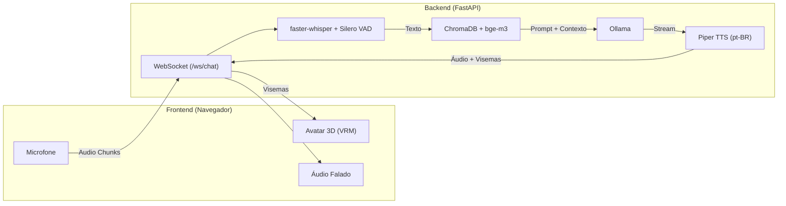

# 🤖 Talking Avatar (Avatar Falante com IA)

Assistente virtual interativo com avatar 3D falante, reconhecimento de fala (STT), inteligência contextual baseada em documentos (RAG) e síntese de voz (TTS) — **100% Open Source e com execução local**.

---

## 🌟 Destaques do Projeto

* **Privacidade & Conformidade LGPD:** Todo o processamento de áudio, transcrição, recuperação de documentos e geração de fala acontece localmente. Nenhum dado é enviado para nuvens externas.
* **Baixa Latência Conversacional:** Streaming assíncrono por sentença (*sentence chunking*) via WebSockets.
* **Avatar 3D & Lip-Sync:** Renderização no navegador com suporte a modelos `.vrm` e sincronização labial (visemas).
* **Custo Zero de APIs:** Utiliza modelos abertos como Ollama (Qwen/Llama), faster-whisper e Piper TTS.

---

## 🏗️ Arquitetura

---

## 📚 Documentação

* [Trilha e Diretrizes Técnicas](trilha_avatar_ia.md)
* [Mapa de Arquitetura e Contratos](project_map.md)
* [Backlog de Tarefas](tasks.md)
* [Diretrizes de Agente](AGENTS.md)
