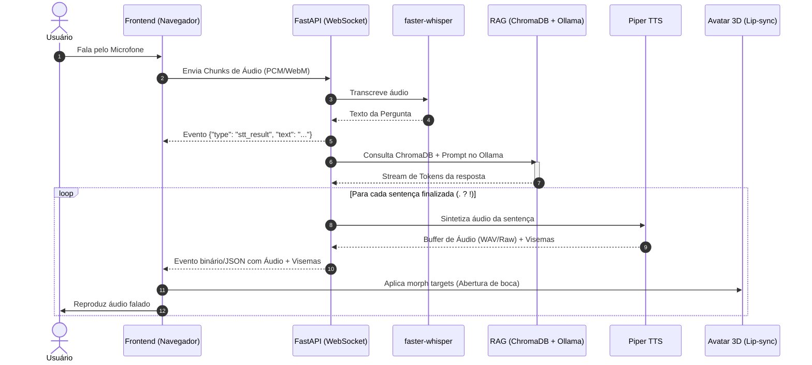

# 🗺️ Project Map: Avatar Falante com IA (100% Open Source)

Este documento detalha o mapa do projeto, arquitetura de componentes, convenções de código, estrutura de diretórios e contratos de dados.

---

## 📂 Estrutura de Diretórios Recomendada

```text
avatar-falante/
├── README.md                      # Apresentação e documentação do repositório
├── .gitignore                     # Regras de exclusão de arquivos e binários
├── trilha_avatar_ia.md            # Plano e guia da trilha
├── tasks.md                       # Acompanhamento granular de tarefas
├── project_map.md                 # Este mapa técnico do projeto
├── AGENTS.md                      # Regras e diretrizes operacionais do agente
├── GEMINI.md                      # Ponto de entrada de regras do agente
├── docker-compose.yml             # Orquestração de containers da solução
├── .env.example                   # Modelo de variáveis de ambiente
│
├── backend/                       # Backend em Python (FastAPI)
│   ├── main.py                    # Ponto de entrada da API e servidor WebSocket
│   ├── config.py                  # Parâmetros e variáveis de ambiente
│   ├── requirements.txt           # Dependências Python
│   │
│   ├── core/                      # Orquestração do pipeline de voz e chat
│   │   ├── pipeline.py            # Coordenação: Audio -> STT -> RAG -> TTS -> WS
│   │   └── vad.py                 # Detecção de voz (Silero VAD)
│   │
│   ├── rag/                       # Módulo de RAG
│   │   ├── ingest.py              # Indexação de documentos e PDFs
│   │   ├── retriever.py           # Busca vetorial e re-ranking
│   │   └── chain.py               # Prompt templates e integração com Ollama
│   │
│   ├── speech/                    # Módulos de voz
│   │   ├── stt.py                 # faster-whisper (transcrição de fala para texto)
│   │   └── tts.py                 # Piper TTS (geração de áudio streaming pt-BR)
│   │
│   └── tests/                     # Testes de integração e benchmarks de latência
│
├── frontend/                      # Interface Web do Avatar 3D
│   ├── index.html                 # Página principal
│   ├── package.json               # Dependências JS (caso use Vite) ou CDN
│   ├── src/
│   │   ├── app.js                 # Lógica de conexão WebSocket e UI
│   │   ├── audio.js               # Captura de microfone e reprodução de áudio
│   │   └── avatar.js              # Three.js / TalkingHead.js e lip-sync
│   └── assets/
│       ├── models/                # Arquivos .vrm do avatar 3D
│       └── sounds/                # Sons auxiliares (ativação, beep)
│
├── data/                          # Dados locais persistentes
│   ├── documents/                 # PDFs de entrada para a base de conhecimento
│   └── vector_store/              # Banco vetorial ChromaDB persistido
│
└── models/                        # Modelos e binários locais
    ├── piper/                     # Binário do Piper e vozes onnx (.onnx + .json)
    └── whisper/                   # Cache de modelos do faster-whisper
```

---

## ⚡ Fluxo de Dados e Ciclo de Vida da Conversa



---

## 🔌 Protocolo WebSocket (`/ws/chat`)

### 1. Mensagens do Cliente para o Servidor (Frontend → Backend)
- **Áudio em tempo real:** Chunks binários (Int16 / Float32 PCM ou Blob WebM).
- **Controle:**
  ```json
  {
    "event": "start_speaking"
  }
  ```
  ```json
  {
    "event": "stop_speaking"
  }
  ```
  ```json
  {
    "event": "interrupt"
  }
  ```

### 2. Mensagens do Servidor para o Cliente (Backend → Frontend)
- **Transcrição do usuário:**
  ```json
  {
    "type": "transcript",
    "text": "Qual o horário da secretaria?",
    "is_final": true
  }
  ```
- **Texto parcial da resposta (para legendas/chat):**
  ```json
  {
    "type": "llm_chunk",
    "delta": "A secretaria funciona das 8h às 18h."
  }
  ```
- **Pacote de Áudio com Visemas:**
  ```json
  {
    "type": "audio_chunk",
    "audio_base64": "<base64_wav_data>",
    "visemes": [
      {"time_ms": 0, "blendshape": "aa", "weight": 0.8},
      {"time_ms": 120, "blendshape": "ee", "weight": 0.6}
    ]
  }
  ```

---

## 🛠️ Stack Tecnológico Resumido

| Camada | Tecnologia | Justificativa |
| :--- | :--- | :--- |
| **LLM Inference** | Ollama | Fácil deploy local, API OpenAI-compatível, otimizado para CPU/GPU |
| **Embeddings** | `bge-m3` | Melhor modelo multilíngue open-source para busca densa e semântica |
| **Vector DB** | ChromaDB | Sem dependências de serviços externos, persistência local simples |
| **STT** | faster-whisper | Inferência de 2 a 4x mais rápida em CPU através do CTranslate2 |
| **TTS** | Piper | Síntese neural pt-BR offline, ultra-leve e nativamente rápida |
| **Orquestrador** | FastAPI (AsyncIO) | Alto desempenho e suporte nativo a WebSockets assíncronos |
| **Frontend 3D** | Three.js / TalkingHead.js | Suporte a avatares VRM no navegador sem necessidade de plugins |
