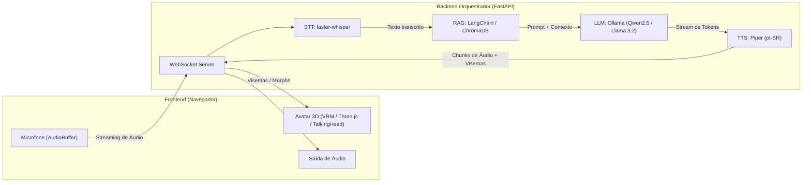

# 🎓 Trilha: Avatar Falante com IA (100% Open Source)

Este documento descreve o plano operacional completo para construção de um atendente virtual com avatar 3D, síntese e reconhecimento de voz, e base de conhecimento própria (RAG), tudo executado localmente e com tecnologias open source.

---

## 🗺️ Visão Geral da Arquitetura

---

## 1️⃣ Etapa 1: Chatbot Local (Motor Base & Persona)

### Objetivo
Validar a execução de LLMs locais com baixo consumo de hardware e refinar o prompt de sistema do atendente virtual.

### Componentes Técnicos
- **Runtime LLM:** [Ollama](https://ollama.com/)
  - *Hardware padrão / sem GPU dedicada:* `llama3.2:3b` ou `qwen2.5:3b-instruct-q4_K_M` (respostas rápidas e ótimo português).
  - *Com GPU (VRAM >= 6GB-8GB):* `qwen2.5:7b-instruct-q4_K_M` ou `llama3.1:8b`.
- **Interface Prototipagem:** Streamlit ou Gradio (chat com streaming ativo via `ollama-python`).

### Entregáveis
1. Arquivo `Modelfile` customizado no Ollama fixando:
   - Tom de voz acolhedor, profissional e direto (respostas concisas são fundamentais para reduzir a latência de voz).
   - Diretriz para evitar formatação Markdown pesada (tabelas, listas longas não soam naturais faladas em voz alta).
2. Interface de teste para validação de métricas de geração (Tokens por segundo / Time-To-First-Token).

---

## 2️⃣ Etapa 2: RAG (Base de Conhecimento Própria)

### Objetivo
Capacitar o atendente a responder estritamente com base nos PDFs e documentos institucionais da disciplina/organização, citando fontes e prevenindo alucinações.

### Componentes Técnicos
- **Framework:** LangChain ou LlamaIndex.
- **Leitor de Documentos:** `PyPDFLoader` / `pdfplumber` ou `Docling`.
- **Chunking:** `RecursiveCharacterTextSplitter` (tamanho: 500-700 tokens, overlap: 100 tokens).
- **Modelo de Embedding:** `BAAI/bge-m3` (suporte multilíngue de alta precisão via `sentence-transformers` / `FastEmbed` ou `nomic-embed-text` via Ollama).
- **Banco Vetorial:** ChromaDB (embutido, sem necessidade de servidor externo na fase inicial) ou Qdrant local.

### Entregáveis
1. Script de ingestão e indexação (`ingest.py`).
2. Cadeia de QA com filtro de relevância (score threshold) e prompt que instrui o bot a dizer honestamente quando não souber a resposta.

---

## 3️⃣ Etapa 3: Pipeline de Voz (STT & TTS de Baixa Latência)

### Objetivo
Transformar a interação em conversação fluida por áudio, otimizando o pipeline para latência humana aceitável (< 1.5s entre o término da fala e o início da resposta do bot).

### Componentes Técnicos
- **Entrada (STT - Speech to Text):**
  - `faster-whisper` (motor CTranslate2, até 4x mais rápido que o Whisper original em CPU).
  - Modelo: `small` ou `base` configurado para português (`language="pt"`).
  - VAD (Voice Activity Detection) integrado com `Silero VAD` para detecção precisa do fim da fala.
- **Saída (TTS - Text to Speech):**
  - [Piper TTS](https://github.com/rhasspy/piper): síntese neural ultrarrápida projetada para rodar em Raspberry Pi e CPUs comuns.
  - Modelo pt-BR: `pt_BR-faber-medium` ou `pt_BR-edresson-low`.

### Estratégia de Streaming & Latência
- **Sentence Chunking:** Não esperar a LLM terminar de gerar todo o texto. Assim que um delimitador de sentença for detectado (`.`, `?`, `!`, `\n`), enviar o trecho imediatamente para o Piper gerar o primeiro bloco de áudio.

---

## 4️⃣ Etapa 4: Avatar 3D no Navegador & Lip-Sync

### Objetivo
Renderizar um modelo 3D interativo na web com movimentação labial (visemas) sincronizada com a fala e animações realistas em repouso.

### Componentes Técnicos
- **Opção A (Alta Produtividade):** [TalkingHead.js](https://github.com/met4citizen/TalkingHead)
  - Já resolve lipsync em tempo real, expressões, piscar de olhos e controle de câmera.
- **Opção B (Customizável):** Three.js + `@pixiv/three-vrm`
  - Carregamento de modelos padronizados `.vrm` (exportados do VRoid Studio ou Ready Player Me).
  - Controle de blendshapes para visemas (`aa`, `ih`, `ou`, `ee`, `oh`).
- **Extração de Visemas / Lip-Sync:**
  - Extração via fonemas retornados pelos metadados do Piper TTS, ou
  - Análise em tempo real de amplitude e espectro de frequência no navegador via `Web Audio API` (FFT para modular a abertura de boca).

---

## 5️⃣ Etapa 5: Orquestração e Integração em Tempo Real

### Objetivo
Conectar todas as partes em um fluxo bidirecional e assíncrono.

### Arquitetura de Comunicação
- **Backend:** FastAPI com endpoint WebSocket (`/ws/chat`).
- **Protocolo de Mensagens (JSON):**
  - Frontend envia: Áudio gravado (chunks WebM / PCM) + eventos de início/fim de fala.
  - Backend transmite:
    1. Transcrição intermediária (para feedback visual imediato).
    2. Tokens de texto parciais.
    3. Buffers de áudio gerados pelo Piper.
    4. Marcadores de visemas/tempo para animação labial.
- *(Opcional Avançado):* Uso do framework [Pipecat](https://github.com/pipecat-ai/pipecat) para gerenciar WebRTC, cancelamento de eco e interrupções pelo usuário (barge-in).

---

## 6️⃣ Etapa 6: Empacotamento, Avaliação e LGPD

### Objetivo
Garantir reprodutibilidade, segurança de dados e conformidade regulatória.

### 1. Docker Compose Multi-serviço
- `ollama`: Serviço com volume persistente para modelos.
- `api`: Backend FastAPI com dependências de IA (PyTorch / faster-whisper / Piper).
- `web`: Servidor estático (Nginx ou Vite) com o visualizador 3D do avatar.

### 2. Avaliação de Qualidade
- Avaliar fidelidade das respostas do RAG (Ragas: Faithfulness e Answer Relevancy).
- Avaliar Naturalidade (MOS - Mean Opinion Score subjetivo da voz do Piper).

### 3. Privacidade e LGPD
- **Processamento 100% Local:** Nenhuma gravação ou documento transita por APIs externas (Google, OpenAI, etc.).
- **Retenção Zero:** Áudios de entrada e saídas intermediárias de fala devem ser mantidos apenas em memória (`io.BytesIO`) e descartados imediatamente após a execução.
- **Transparência e Consentimento:** Aviso explícito ao usuário de que se trata de uma IA e pedido formal de permissão para acesso ao microfone.

---

## 📋 Matriz de Decisão de Hardware

| Cenário de Hardware | LLM Recomendada | Embeddings | Whisper (STT) | TTS |
| :--- | :--- | :--- | :--- | :--- |
| **Apenas CPU (i5/Ryzen 5, 16GB RAM)** | `qwen2.5:3b-instruct-q4_K_M` | `bge-m3` (FastEmbed / INT8) | `faster-whisper` (`base` ou `tiny`) | `piper` (`pt_BR-edresson-low`) |
| **Com GPU (6GB a 8GB VRAM - RTX 3060/4060)** | `qwen2.5:7b-instruct-q4_K_M` ou `llama3.2:3b` | `bge-m3` | `faster-whisper` (`small` ou `medium`) | `piper` (`pt_BR-faber-medium`) |
